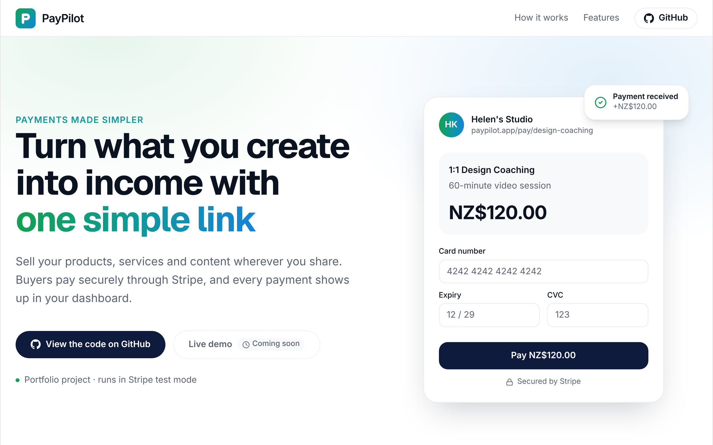

# PayPilot 💳

PayPilot is a full-stack payment links application designed for content creators and digital product sellers to create shareable payment links and accept secure online payments through Stripe.

This MVP demonstrates modern frontend architecture, TypeScript, API integration, payment workflows, form handling, and full-stack collaboration between a React frontend and Node.js backend.

**🔗 Live site: [paypilot-gamma.vercel.app](https://paypilot-gamma.vercel.app)**

The landing page is live. The interactive demo of the creator dashboard is coming soon.

[](https://paypilot-gamma.vercel.app)

---

## ✨ Features

- Create reusable payment links for products or services
- Generate unique public payment URLs
- Accept secure payments using Stripe Payment Element
- Display seller, product, amount, and payment information
- Handle payment success and error states

---

## ✨ Future Improvements

- Track payment link status and usage
- Dashboard for managing payment links
- Payment analytics
- Copy payment links directly from the dashboard
- Responsive user interface
- Accessible form controls and interactions

## 🛠 Tech Stack

### Frontend

- React
- TypeScript
- Vite
- React Router
- React Hook Form
- Tailwind CSS
- shadcn/ui
- Axios
- Lucide React

### Backend

- Node.js
- Express
- Prisma ORM
- PostgreSQL
- Neon
- Stripe API

### Testing (planned)

- React Testing Library
- Jest
- Accessibility-focused queries

---

## 🏗 Architecture

PayPilot separates frontend presentation, API communication, business logic, and persistence concerns.

```text
React + TypeScript
        │
        │ REST API
        ▼
Node.js + Express
        │
        ├──── Stripe API
        │
        ▼
Prisma ORM
        │
        ▼
Neon PostgreSQL
```

The frontend follows a feature-oriented structure to keep functionality modular and easy to extend.

```text
src/
├── components/
├── features/
│   ├── payment-links/
│   ├── payments/
│   └── analytics/
├── pages/
├── services/
├── types/
├── hooks/
└── utils/
```

---

## 💳 Payment Flow

A seller creates a payment link containing:

- Product name
- Description
- Amount
- Currency

PayPilot generates a unique slug that can be shared with a customer.

Example:

```text
/pay/my-product-link
```

When a customer visits the payment page:

1. The frontend requests the payment link using its slug.
2. The backend validates the payment link.
3. The backend creates a Stripe PaymentIntent.
4. Stripe returns a `clientSecret`.
5. The frontend renders Stripe Payment Element.
6. Stripe securely processes the payment.
7. The customer is redirected to the success state once payment is confirmed.

The Stripe secret key always remains on the server and is never exposed to the browser.

---

## 🔌 API

### Get public payment page

```http
GET /api/public/payment-links/:slug
```

Example response:

```json
{
  "paymentLink": {
    "id": "payment-link-id",
    "slug": "design-consultation",
    "productName": "Design Consultation",
    "description": "60 minute consultation",
    "amount": 120,
    "currency": "nzd",
    "sellerName": "PayPilot Seller"
  },
  "clientSecret": "pi_..."
}
```

---

### Create payment link

```http
POST /api/payment-links
```

Example request:

```json
{
  "productName": "Design Consultation",
  "description": "60 minute consultation",
  "amount": 120,
  "currency": "nzd"
}
```

---

### Stripe webhook

```http
POST /api/payments/webhook
```

Stripe webhooks are used to synchronise payment status with PayPilot after payment events occur.

---

## 🗄 Data Model

### User

Represents a PayPilot seller.

### PaymentLink

Stores information required to generate a public payment page.

```text
PaymentLink
├── id
├── slug
├── productName
├── description
├── amount
├── currency
├── status
├── clicks
└── userId
```

### Payment

Stores individual payment records.

```text
Payment
├── id
├── amount
├── currency
├── status
├── stripePaymentIntentId
├── paymentLinkId
├── userId
└── createdAt
```

Amounts are stored internally in the smallest currency unit and converted for display in the frontend.

---

## 🚦 Application States

Special attention is given to handling real-world asynchronous UI states.

The application includes:

- Loading states
- Empty states
- Validation errors
- API errors
- Payment processing
- Payment success
- Payment failure
- Expired payment links
- Missing payment links

For example:

```text
Payment Link
    │
    ├── Loading
    │
    ├── Available
    │      └── Payment processing
    │             ├── Success
    │             └── Failure
    │
    ├── Expired
    │
    └── Not Found
```

---

## ♿ Accessibility

Accessibility is considered throughout the application.

Examples include:

- Semantic HTML
- Proper form labels
- Keyboard-accessible interactions
- Accessible error messages
- Clear loading and payment feedback

---

## 🧪 Testing Strategy (planned)

Tests are not written yet; they are the next milestone, starting with the payment flow and the Stripe webhook.

The planned frontend tests focus on user behaviour rather than implementation details, covering:

- Form validation
- Payment link creation
- Loading states
- API failures
- User interactions
- Accessible form controls
- Success and error flows

Example of the planned style:

```tsx
expect(
  screen.getByRole("button", {
    name: /create payment link/i,
  }),
).toBeInTheDocument();
```

---

## 🔐 Security

PayPilot follows several important payment security principles:

- Stripe secret keys are stored only on the backend
- Payment details are handled directly by Stripe
- Sensitive card information is never stored by PayPilot
- PaymentIntent creation happens server-side
- Environment variables are excluded from source control
- Webhook events are verified before processing

---

## ⚙️ Environment Variables

Copy `.env.example` to `.env` in the project root and fill it in. One file serves both the server and the browser code:

```env
# Server (never exposed to the browser)
DATABASE_URL=your_neon_database_url
STRIPE_SECRET_KEY=your_stripe_test_secret_key
STRIPE_WEBHOOK_SECRET=your_stripe_webhook_secret
PORT=5000

# Browser (Vite builds VITE_* variables into the frontend)
VITE_STRIPE_PUBLISHABLE_KEY=your_stripe_test_publishable_key

# Optional: production shows only the landing page unless this is "true".
# Local development always has the app on.
# VITE_APP_ENABLED=true
```

The frontend calls the API on the same origin (`/api`), so no API URL is needed.

> Never commit `.env` files or Stripe secret keys to Git.

---

## 🚀 Getting Started

The frontend and the Express API run together as one app.

### 1. Clone the repository and install dependencies

```bash
git clone https://github.com/helenkyryliuk/paypilot.git
```

```bash
cd paypilot
```

```bash
npm install
```

Installing also generates the Prisma client (`postinstall` runs `prisma generate`).

---

### 2. Configure environment variables

```bash
cp .env.example .env
```

Then fill in the values described in the Environment Variables section above.

---

### 3. Set up the database

```bash
npx prisma migrate dev
```

```bash
npm run db:seed
```

The seed script creates the demo seller account that payment links belong to.

---

### 4. Start the app

```bash
npm run dev
```

Open [http://localhost:5000](http://localhost:5000). The React app and the API share this port.

---

## ☁️ Deployment

PayPilot is deployed on **Vercel**, and every push to `main` deploys automatically:

- The React app is built with Vite and served as static files.
- The Express app runs as a single Vercel Function (`api/index.ts`). `vercel.json` routes `/api/*` to it and every other path to the React app.
- Database schema changes are applied to production with `npm run db:migrate:deploy`.
- `VITE_APP_ENABLED` is a feature flag: while it is unset, production serves only the landing page.

---

## 🧭 Main Pages

```text
/                    Landing page
/dashboard           Payment links dashboard
/create-payment      Create a payment link
/analytics           Analytics
/pay/:slug           Public payment page
/pay/:slug/success   Payment confirmation
```

### Dashboard

View and manage existing payment links.

### Create

Create a new payment link.

### Analytics

View payment and payment-link activity.

### Public Payment Page

Customers use `/pay/:slug` to securely complete their payment.

---

## 🎯 Engineering Goals

PayPilot was intentionally designed as more than a simple CRUD application.

The project focuses on demonstrating:

- Clean frontend architecture
- Strong TypeScript usage
- Complex UI state management
- API abstraction
- Third-party integrations
- Secure payment workflows
- Maintainable component design
- Form architecture
- Accessibility
- Automated testing (in progress)
- Error and edge-case handling
- Product-focused frontend development

---

## 🗺 Future Improvements

Potential future additions include:

- Authentication and user accounts
- Advanced payment analytics
- Payment-link expiration
- Single-use payment links
- Refund management
- Email receipts
- Improved webhook event handling
- Additional currencies
- Subscription payments
- Automated tests for the payment flow and Stripe webhook

---

## 👩‍💻 About the Project

PayPilot was built as a portfolio project to stay actively engaged with modern frontend and SaaS development practices while exploring payment architecture using Stripe.

The project reflects my professional interests in:

- React and TypeScript
- SaaS products
- Payment experiences
- Complex frontend state
- Scalable application architecture
- Accessibility
- Testing
- Customer-focused product development

---

## 📄 License

This project is intended for portfolio and educational purposes.
